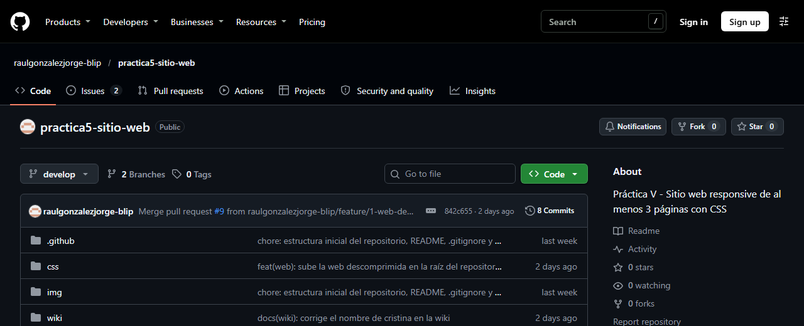
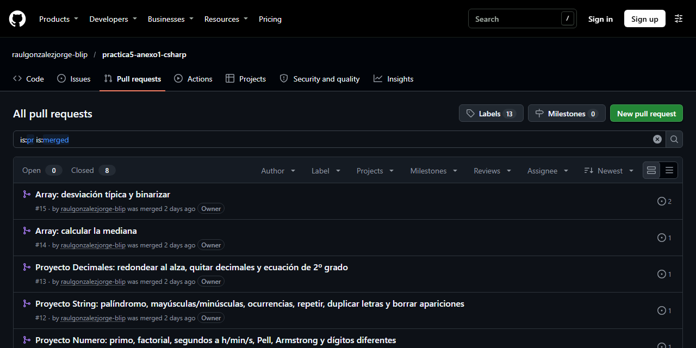

# Guía paso a paso para Cristina: tu fork y tu primer Pull Request

Esta guía es para hacerlo **por primera vez**. Sigue los pasos en orden y no te saltes ninguno.
Al final habrás subido un cambio al repositorio oficial **desde tu propio fork**, que es lo que pide el enunciado.

**Tus datos:** usuario `cristinasabinatorres` · repositorio oficial `practica5-sitio-web` · tarea **#6 Validar HTML y CSS en el W3C y corregir lo que salga**.

| Qué | Enlace |
|-----|--------|
| Repositorio oficial | https://github.com/raulgonzalezjorge-blip/practica5-sitio-web |
| Aceptar la invitación (con tu sesión iniciada) | https://github.com/raulgonzalezjorge-blip/practica5-sitio-web/invitations |
| Tu fork (existe **después** del paso 1) | https://github.com/cristinasabinatorres/practica5-sitio-web |
| Tablero de tareas | https://github.com/users/raulgonzalezjorge-blip/projects/4/views/2 |

## Dónde van las capturas

En **cada paso marcado con 📸** haz una captura de pantalla (tecla **Windows + Mayús + S**) y pégala en el **documento compartido de la práctica**, apartado **2.2 (Página Web)**, sección «Capturas del fork y del Pull Request». Cada paso tiene su hueco amarillo «[ Pega aquí la captura ]»: pega la imagen encima y borra ese texto. Si en alguna captura sale tu email, tápalo antes de pegarla.

## Antes de empezar: qué es cada cosa

- **Repositorio oficial**: el de Raúl (`raulgonzalezjorge-blip/practica5-sitio-web`). Solo entra código en él mediante Pull Request.
- **Fork**: tu copia del repositorio oficial en tu cuenta (`cristinasabinatorres/practica5-sitio-web`). Ahí puedes subir lo que quieras sin romper nada.
- **Rama**: una línea de trabajo dentro del repositorio. Cada tarea va en su rama `feature/<nº>-<descripción>`.
- **Pull Request (PR)**: la petición para que el jefe revise tu rama y la meta en `develop` del repositorio oficial.

## Paso 0. Instalar y configurar Git (solo la primera vez)

1. Instala Git desde <https://git-scm.com/download/win> (siguiente, siguiente… con las opciones por defecto).
2. Abre **Git Bash** (o la terminal de VS Code) y dile a Git quién eres. Usa el **email de tu cuenta de GitHub**:
```
git config --global user.name "Tu Nombre Apellido"
git config --global user.email "el-email-de-tu-cuenta-de-github"
git config --global core.autocrlf true
```
`core.autocrlf true` evita que Windows y Linux se peleen por los saltos de línea.

Comprueba que está bien:
```
git config --global --list
```

> 📸 **Captura para el documento:** Git configurado: la terminal con `git --version` y `git config --global user.name`.

## Paso 1. Hacer el fork (en la web)

1. Inicia sesión en GitHub y entra en el repositorio oficial: `https://github.com/raulgonzalezjorge-blip/practica5-sitio-web`
2. Pulsa el botón **Fork**, arriba a la derecha, al lado de **Star**:



3. En la pantalla siguiente deja todo como está y pulsa **Create fork**.
4. Ahora estás en `https://github.com/cristinasabinatorres/practica5-sitio-web`. Debajo del nombre pone «forked from raulgonzalezjorge-blip/practica5-sitio-web». Ese es tu fork.

> 📸 **Captura para el documento:** Fork creado: tu página del fork, donde se lea «forked from raulgonzalezjorge-blip/…».

## Paso 2. Clonar tu fork en tu ordenador

Clona **tu fork** (no el de Raúl) y entra en la carpeta:
```
cd ~/Documents
git clone https://github.com/cristinasabinatorres/practica5-sitio-web.git
cd practica5-sitio-web
```
La primera vez que hagas `push`, Windows abrirá una ventana para iniciar sesión en GitHub: acepta.

## Paso 3. Enlazar el repositorio oficial como `upstream`

Así podrás traerte lo último que haya en el oficial:
```
git remote add upstream https://github.com/raulgonzalezjorge-blip/practica5-sitio-web.git
git remote -v
```
Debes ver cuatro líneas: `origin` apunta a tu fork y `upstream` al de Raúl.

> 📸 **Captura para el documento:** Clonado y upstream (pasos 2 y 3): la terminal con `git clone` y `git remote -v`.

## Paso 4. Ponerte al día y crear la rama de tu tarea

1. En el tablero (enlace «Tablero de tareas» de la tabla de arriba) mueve tu tarea de **TO DO** a **DOING**.
2. Trae lo último de `develop` y crea tu rama desde ahí:
```
git fetch upstream
git switch -c develop upstream/develop
git switch -c feature/6-validar-w3c
```
Si `develop` ya existe, usa `git switch develop` y luego `git pull upstream develop`.

> 📸 **Captura para el documento:** Rama creada: la terminal con `git switch -c …` y el tablero con tu tarea en DOING.

## Paso 5. Hacer el cambio

Trabaja con tu editor como siempre. Cuando termines una parte que funcione:
```
git status
git add index.html css/estilos.css
git commit -m "fix(web): corrige los errores del validador del W3C (#6)"
```
- `git status` te dice qué archivos han cambiado (en rojo, sin preparar; en verde, preparados).
- `git add` prepara solo los archivos de la tarea. Nunca subas `.zip`, `.exe` ni carpetas `bin/` u `obj/`.
- El mensaje sigue el formato `tipo(ámbito): qué hace (#nº)`. Tipos: `feat`, `fix`, `style`, `docs`.

Repite `add` + `commit` cada vez que termines algo: mejor varios commits pequeños que uno enorme.

> 📸 **Captura para el documento:** Commit: la terminal con `git status` y `git commit`.

## Paso 6. Subir la rama a tu fork
```
git push -u origin feature/6-validar-w3c
```
Si sale `Permission denied` o `403`, estás subiendo a `upstream`: sube a `origin`.

> 📸 **Captura para el documento:** Push: la terminal con `git push -u origin …`.

## Paso 7. Abrir el Pull Request

1. Entra en tu fork en GitHub. Arriba saldrá un aviso amarillo con el botón **Compare & pull request**: púlsalo.
2. Comprueba la línea de arriba **antes de crear nada**:
   `base repository: raulgonzalezjorge-blip/practica5-sitio-web` · `base: develop` ← `head repository: cristinasabinatorres/practica5-sitio-web` · `compare: feature/6-validar-w3c`
3. Título: qué hace el cambio. En la descripción escribe `Closes #6` y marca el checklist.
4. Pulsa **Create pull request**.

Así se ven los Pull Request ya fusionados del Anexo I:



> 📸 **Captura para el documento:** Pull Request abierto: la página del Pull Request con `base: develop` y «Closes #…».

## Paso 8. Si el jefe pide cambios

Haz los cambios en la **misma rama**, `git add`, `git commit` y `git push`. El Pull Request se actualiza solo; no abras otro.

## Paso 9. Cuando el jefe lo fusione

La tarea se cierra sola gracias a `Closes #6` y pasa a **DONE**. Actualiza tu copia y borra la rama:
```
git switch develop
git pull upstream develop
git push origin develop
git branch -d feature/6-validar-w3c
```

> 📸 **Captura para el documento:** Fusionado: el Pull Request en morado («Merged») y tu tarea en DONE.

## Errores frecuentes

| Mensaje | Qué pasa | Solución |
|---------|----------|----------|
| `rejected ... fetch first` | El remoto tiene cambios que tú no tienes | `git pull upstream develop`, resuelve conflictos y `git push` |
| `CONFLICT (content)` | Tú y otra persona tocasteis las mismas líneas | Abre el archivo, deja el código bueno entre `<<<<<<<`, `=======` y `>>>>>>>`, borra las marcas, `git add` y `git commit` |
| `Permission denied` / `403` | Estás subiendo al repositorio de Raúl | Sube a `origin` (tu fork) |
| `fatal: not a git repository` | No estás dentro de la carpeta del repositorio | `cd practica5-sitio-web` |
| He trabajado en `develop` sin rama | — | `git switch -c feature/<nº>-<nombre>`: los cambios se pasan a la rama nueva |

Si te atascas, copia el mensaje de error entero y pásaselo a Raúl.
